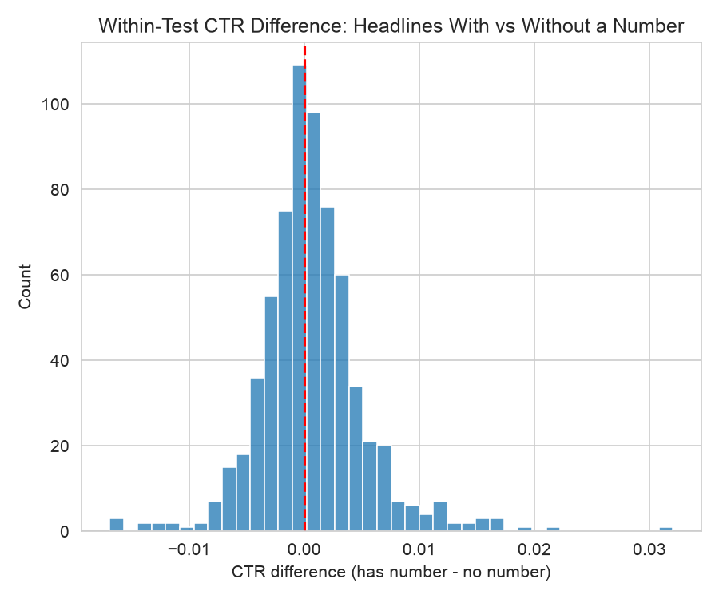
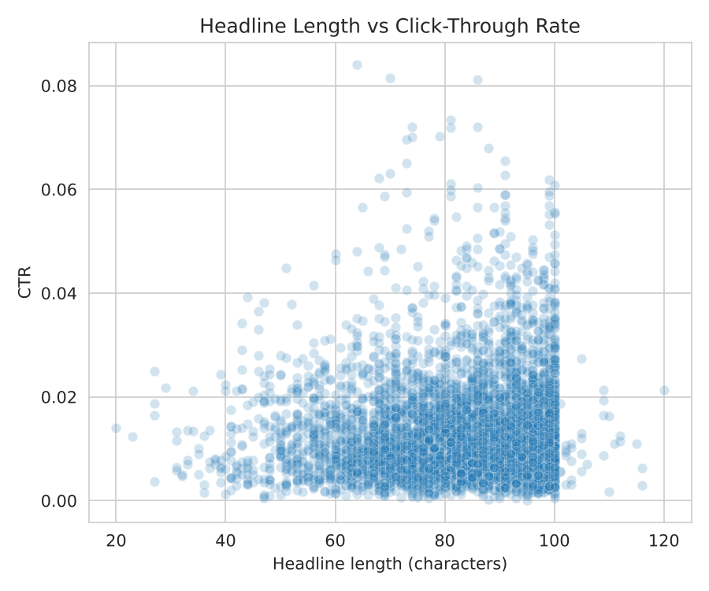

# What Makes a Headline Get More Clicks? An A/B Testing Analysis of Upworthy Experiments

**SQL (MySQL) + Python | Experiment validation, within-test statistical analysis, meta-analysis**

> I analysed 18,000+ headline variants from thousands of real randomized A/B tests run by Upworthy to find out whether numbers, questions, or headline length are linked to higher click-through rate (CTR), while respecting the experimental design instead of pooling everything together.

---

## Project Summary

Upworthy, a digital media company, tested multiple headlines ("packages") for the same article by randomly showing them to different visitors. Each test records how many times each headline was shown (impressions) and clicked (clicks).

This project asks three practical, product-style questions:

1. Do headlines that **contain a number** get a higher CTR?
2. Do headlines phrased as a **question** get a higher or lower CTR?
3. Is **headline length** associated with CTR?

The main design decision: **compare headlines only against other headlines from the same test.** Different articles have very different baseline appeal, so simply averaging CTR across all headlines would mix up "good article" with "good headline". Comparing within a test removes most of that noise.

The work is split into two stages:

| Stage | Tool | What I did |
|-------|------|-----------|
| 1. Data validation and cleaning | **SQL (MySQL)** | Row counts, null/duplicate/invalid-metric checks, test structure, removal of a documented randomization-problem period, creation of clean analysis tables, exploratory feature summaries |
| 2. Statistical analysis | **Python** (pandas, SciPy, statsmodels, seaborn) | Case study of one experiment, paired within-test comparisons, hypothesis tests, correlation analysis, visualizations |

---

## Key Results at a Glance

| Headline feature | Result (within-test comparison) | Statistical evidence | Practical takeaway |
|---|---|---|---|
| **Contains a number** | CTR **+0.065 percentage points** vs. no-number headlines in the same test (673 paired tests) | Paired t-test p = 0.0003; Wilcoxon p = 0.002 | Small positive effect |
| **Is a question** | CTR **-0.133 percentage points** vs. non-question headlines in the same test (578 paired tests) | Paired t-test and Wilcoxon p < 0.00001 | Larger negative effect, questions tended to underperform |
| **Headline length** | Weak positive association (Spearman rho = 0.083) | p < 0.00001 | Statistically significant but very weak; not a useful rule on its own |

**Bottom line:** Headline formats show consistent but modest average effects. They are useful hypotheses to test, not universal rules. Continued A/B testing is still the best way to decide on any specific headline.

*(For context, the overall CTR in the cleaned data is about 1.31%, so a 0.135 percentage point drop is roughly a 10% relative difference.)*

---

## Dataset

- **Source:** the [Upworthy Research Archive](https://upworthy.natematias.com/) (J. N. Matias, K. Munger, M. A. Le Quere, C. Ebersole, *Scientific Data*, 2021, DOI: 10.1038/s41597-021-00934-7). It contains headline A/B tests run by Upworthy between 2013 and 2015. This project uses the archive's **exploratory release**.
- **Randomization issue:** in a 2024 author correction (DOI: 10.1038/s41597-024-03600-w), the archive authors reported likely randomization problems in tests run between **25 June 2013 and 10 January 2014** and advised researchers doing causal analysis to omit them. The CSV used here predates the `problem` flag that was added later, so I recreated it from `created_at`.
- **File used:** `upworthy-archive-exploratory-packages-03.12.2020.csv` (loaded as UTF-8; 2,534 headlines contain curly quotes or dashes)

---

## Approach

### Stage 1: Data validation and cleaning in SQL

The SQL scripts in `sql/` are numbered in the order I ran them.

| Scripts | Purpose |
|---|---|
| `sql1` to `sql3` | Row count, test count (4,873 tests), null check across all key columns (no nulls found) |
| `sql4` to `sql5` | Duplicate check (22,666 unique records) and invalid-metric check (no zero impressions, negative clicks, or clicks > impressions) |
| `sql6` to `sql8` | Test structure: how many headline variants per test (most tests have 4), sample rows |
| `sql9` to `sql10` | **Randomization check.** Identified 4,278 packages from 1,050 tests created between 2013-06-25 and 2014-01-10, the period the archive authors flag as having a randomization problem |
| `sql11` to `sql12` | Built `valid_tests` and `packages_clean` tables, keeping only tests with 2+ packages and excluding the problem period |
| `sql13` to `sql14` | Clean-data summary and headline-feature summaries (number, question, length buckets) |
| `sql15` | Analysis of the `winner` flag against headline features |
| `sql16` | Test-level paired comparisons (number vs. no number, question vs. statement, shorter vs. longer than the test's average) |

**Why exclude the problem period?** A/B testing only works if assignment is truly random. If it was not, differences in CTR cannot be trusted as headline effects, so I removed those experiments rather than risk misleading conclusions.

**Cleaning funnel (SQL):**

| Step | Packages | Tests |
|---|---:|---:|
| Raw data | 22,666 | 4,873 |
| After removing randomization-problem period and tests with fewer than 2 packages | **18,388** | **3,823** |

The cleaned data covers about **64.2 million impressions** and **843,538 clicks** (overall CTR of about 1.31%).

### Stage 2: Statistical analysis in Python

1. **Case study:** examined one real experiment (the test with the most impressions) and ran a two-proportion z-test between its best and worst headline (z = 3.89, p = 0.0001) to show how a single A/B test works.
2. **Feature engineering:** `has_number` (contains a digit), `is_question` (ends with "?"), `headline_length` (characters).
3. **Paired meta-analysis:** for each test containing both kinds of headline, I computed the difference in mean CTR (feature minus no-feature), then tested whether those differences are centred on zero using a **one-sample t-test** and the non-parametric **Wilcoxon signed-rank test** as a robustness check.
4. **Length analysis:** Spearman rank correlation between headline length and CTR.

---

## Detailed Findings

### 1. Numbers in headlines
- Paired tests: **673** tests had both a number-containing and a no-number headline.
- Mean within-test CTR difference: **+0.0651 percentage points** (t = 3.634, p = 0.0003; Wilcoxon p = 0.0022).
- Both tests agree, so the small positive effect is not just an artifact of one test's assumptions.

### 2. Question headlines
- Paired tests: **577**.
- Mean within-test CTR difference: **-0.1328 percentage points** (t = -7.355, p < 0.00001; Wilcoxon p < 0.00001).
- Question headlines were also more rarely the winning variant in the exploratory SQL summary (winner rate 4.67% vs. 4.90% for statements), though that gap is small.

### 3. Headline length
- Spearman rho = **0.0826** (p < 0.00001) on the cleaned data.
- With this many rows, even a tiny correlation is "significant". The effect size is very small, so length alone is not a strong predictor.

### 4. Exploratory SQL summaries 

| Group | Packages | Overall CTR |
|---|---:|---:|
| Contains number | 3,553 | 1.33% |
| No number | 14,835 | 1.31% |
| Question | 1,435 | 1.10% |
| Statement | 16,953 | 1.33% |
| Short (<50 chars) | 435 | 1.17% |
| Medium (50-79) | 6,557 | 1.22% |
| Long (80-109) | 11,369 | 1.37% |
| Very long (110+) | 27 | 1.01% |

The pooled and within-test results point in the same direction for numbers and questions.

---

## Visualizations

| Within-test CTR difference: number vs. no number | Headline length vs. CTR |
|:---:|:---:|
|  |  |

---

## Scope, Design Choices and Limitations

Each choice below was deliberate, and each has a known boundary on what the results can claim.

**1. Randomization quality was treated as a first-class data-quality issue.**
1,050 tests (4,278 packages) fall in a window the archive documents as having a randomization problem. I excluded them at the *test* level in SQL rather than risk attributing assignment bias to headline effects. The trade-off is a smaller sample (3,823 of 4,873 tests retained).

**2. Within-test comparison controls for article, not for wording.**
Comparing headlines only against siblings from the same test removes article-level differences in baseline appeal. Headlines with a number or a question mark also differ in phrasing and framing, so the estimates describe how these formats perform *on average in practice*, not an isolated causal effect of a digit or a "?". Isolating that would need a purpose-built experiment that varies only the feature.

**3. Effect sizes are reported alongside p-values.**
With roughly 18,000 packages, small effects reach significance easily. The number effect (+0.066 pp) and the length correlation (rho = 0.083) are statistically significant but small; the question effect (-0.133 pp, about 10% relative to the 1.31% baseline) is the only one I consider practically meaningful.

**4. Length was analysed with a pooled rank correlation.**
Spearman's rho captures a monotonic relationship without assuming linearity, but it pools all headlines. The within-test length comparison exists in SQL (`sql16`) and is the natural extension of the Python analysis.

**5. The SQL and Python stages were reconciled.**
The SQL stage excludes the problem period by calendar date and produces 18,388 packages from 3,823 tests. An early version of the notebook compared raw timestamps against midnight on 10 January 2014, which kept 27 packages (from 6 tests) created later that day and gave 18,415 rows and 3,829 tests. I fixed the filter to compare dates, so the notebook now reproduces the SQL counts exactly. The conclusions did not change (number +0.066 pp, question -0.133 pp, length rho = 0.083).

**6. Historical data.**
The tests ran in 2013 to 2015, so the findings describe that audience and platform and are best used to generate hypotheses for current testing.

---

## Repository Structure

```
upworthy-headline-ab-testing/
├── data/
│   └── raw/                  # Place the downloaded Upworthy CSV here (not tracked by git)
├── sql/
│   ├── sql1_row_count.sql ... sql16_test_level_analysis.sql
│   └── outputs/              # CSV outputs of each SQL query
├── notebooks/
│   └── upworthy_ab_testing.ipynb   # Python analysis and narrative
├── plots/
│   ├── number_headline_diff.png
│   └── length_vs_ctr.png
├── .gitignore
└── README.md
```

---

## How to Reproduce

### Prerequisites
- Python 3.9+ with: `pandas`, `numpy`, `matplotlib`, `seaborn`, `scipy`, `statsmodels`, `jupyter`
- MySQL 8+ (the SQL uses `REGEXP`, `CHAR_LENGTH`, and `CONCAT_WS`)

### Steps

```bash
# 1. Clone the repo
git clone https://github.com/SansK552/upworthy-headline-ab-testing.git
cd upworthy-headline-ab-testing

# 2. Install Python dependencies
pip install pandas numpy matplotlib seaborn scipy statsmodels jupyter

# 3. Download the Upworthy exploratory packages CSV from the archive
#    and place it in data/raw/ (read it as UTF-8)

# 4. (Optional) SQL stage
#    Create a database called upworthy_ab, import the CSV into a table named `packages`,
#    then run the scripts in sql/ in numeric order (sql1 -> sql16).

# 5. Python stage
jupyter notebook notebooks/upworthy_ab_testing.ipynb
```

> The notebook reads the raw CSV directly, so you can run the Python stage without MySQL.

---

## Tech Stack and Skills Demonstrated

| Area | Details |
|---|---|
| **SQL (MySQL)** | Data profiling, null/duplicate/validity checks, aggregation, CTEs, CASE expressions, regex feature extraction, creating derived tables, test-level pivoting |
| **Python** | pandas, NumPy, SciPy, statsmodels, seaborn, matplotlib |
| **Statistics** | A/B test design, two-proportion z-test, paired t-test, Wilcoxon signed-rank test, Spearman correlation, effect size vs. significance |
| **Data quality** | Identifying and handling a documented randomization issue before analysis |
| **Communication** | Translating statistical output into product implications and clearly stated limitations |

---

## Next Steps

- **Mixed-effects / fixed-effects regression** with `clickability_test_id` as the grouping term, estimating the number, question and length effects jointly and controlling for each other.
- **Within-test length analysis** to complete the length question with the same paired design as the other two features.
- **Confidence intervals and relative lift** for every feature, so effects are expressed in business terms and not only as percentage-point differences.
- **Text-feature expansion:** sentiment, readability, emotional words, named entities and curiosity-gap phrasing, via NLP.
- **Load the SQL output directly:** have the notebook read the `packages_clean` table produced in SQL, so both stages share one cleaned dataset by construction.
- **Predictive model:** gradient-boosted model on headline features to estimate which variant is likely to win a test.
